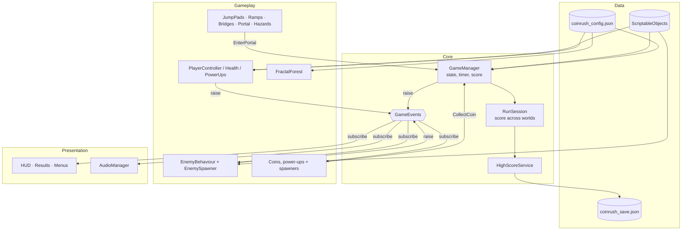

# Architecture
Back to [[00 Coin Rush Design Index]]

Systems are decoupled through a static event hub, `Core/GameEvents.cs`: producers raise events and the UI, audio and spawners subscribe.

Key events: `StateChanged`, `CountdownTick`, `TimeChanged`, `WorldStarted`, `WorldCompleted`, `PortalOpened`, `DifficultyIncreased`, `ScoreChanged`, `QuotaProgress`, `ComboChanged`, `PointsAwarded`, `HealthChanged`, `StaminaChanged`, `PowerUpChanged`, `PlayerDied`, `Notification`.
