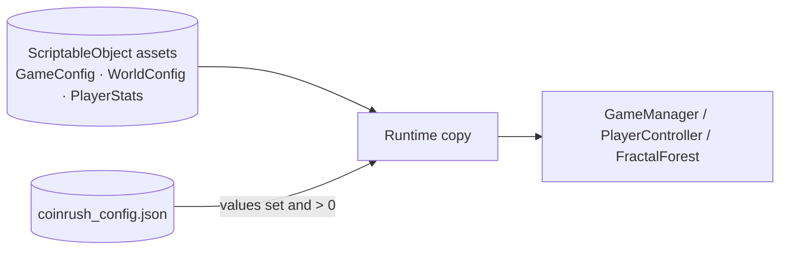
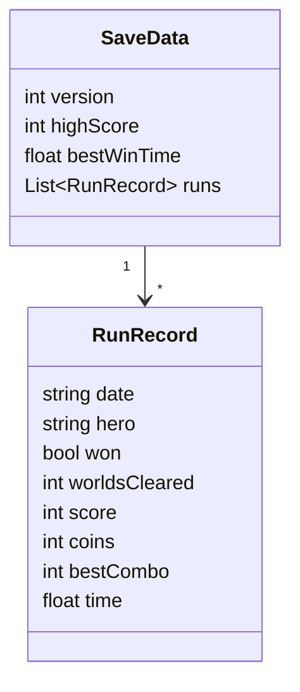

# Config and Save Data
Back to [[00 Coin Rush Design Index]] · `Data/JsonConfig.cs`, `Core/HighScoreService.cs`, builder `CoinRushBuilder.Config.cs`

## External config: `Assets/StreamingAssets/Config/coinrush_config.json`
A plain text file that ships next to the game. **Edit it and press Play; no rebuild is needed** (it is re-read every time a world loads).

| Section | Overrides |
|---|---|
| `rules` | comboWindow, pickupsPerMultiplierStep, maxMultiplier, timeBonusPerSecond, countdownSeconds |
| `player` | walkSpeed, sprintMultiplier, jumpHeight, gravity, dashSpeed, dashCooldown, maxStamina, maxHealth |
| `worlds[]` (matched by `sceneName`) | worldName, coinQuota, timeLimit, maxActiveCoins, gemChance, startingEnemies, maxEnemies, powerUpSpawnInterval, maxPowerUpsOnField |
| `forests[]` (matched by `sceneName`) | treeCount, seed, iterations, branchAngle, trunkLength, trunkRadius, lengthScale, leafSize, barkColor, leafColor |

**Safety:** a missing file, entry, or a zero/empty value keeps the asset's value; overrides are applied to copies, never to the assets. `Coin Rush > Export Config to JSON` regenerates the file from the current assets; Build Everything only creates it if it is missing.

## Save file: `persistentDataPath/coinrush_save.json`

Statistics are LINQ queries over `runs`: `TopRuns(n)` (OrderByDescending/ThenBy/Take), `RankOf(score)` (Count), `Wins`, `AverageScore` (Average), `FavouriteHero` (GroupBy). The file keeps at most 50 runs (the best plus the most recent). Old PlayerPrefs records are migrated on first launch.
On macOS the editor's save is in `~/Library/Application Support/<company>/<product>/`.
