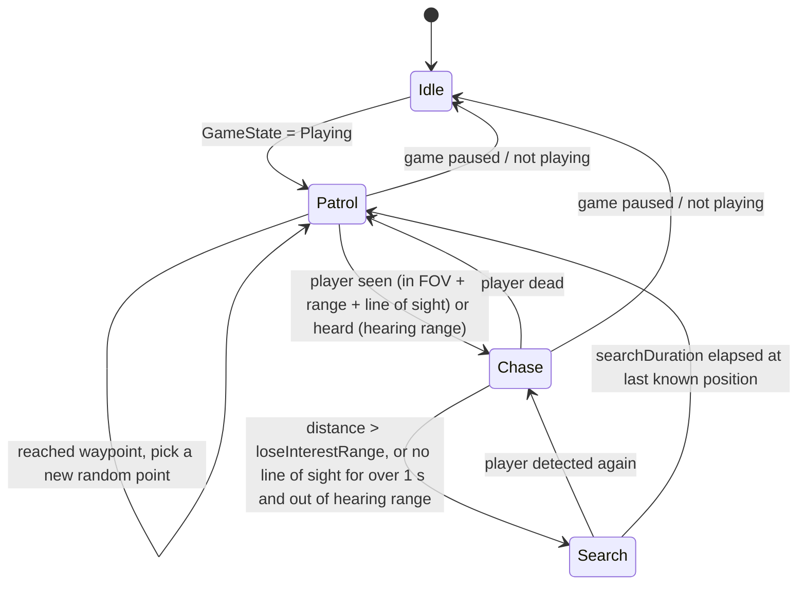

# Enemy Behaviour
Back to [[00 Coin Rush Design Index]] · Implemented in `Enemies/EnemyBehaviour.cs`, `EnemyState.cs`, data in `EnemyStats_Hog/Orc.asset`

The enemies follow simple, hand-written rules (a finite state machine). There is no machine learning or trained AI: the same situation always produces the same reaction.

| Stat | Hog | Orc (brute) |
|---|---|---|
| Patrol / chase speed | 2.5 / 4.6 | 1.8 / 3.9 |
| Sight range / FOV | 9 m / 120° | 12 m / 100° |
| Hearing range | 3.5 m | 4.5 m |
| Damage / cooldown | 15 / 1.6 s | 25 / 2 s |

**Attack:** within `attackRange`, deal damage plus knockback, then pause briefly (`postAttackPause`) so the player can escape.
**Escalation:** see [[Scoring and Combo]]. The brute chance per world comes from `WorldConfig.bruteChance`.
