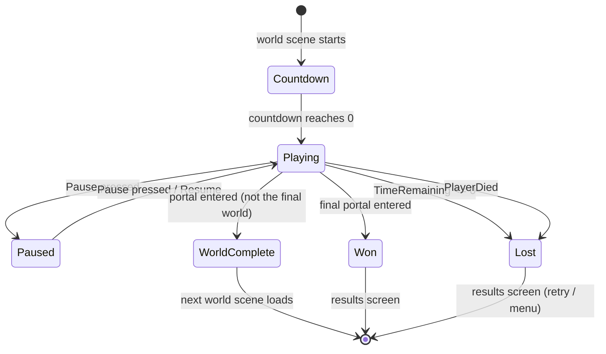

# Game State Machine
Back to [[00 Coin Rush Design Index]] · Implemented in `Core/GameManager.cs` and `Core/GameState.cs`

The `GameManager` is the only system that changes `GameState`; everything else reacts to `GameEvents.StateChanged`.

| State | Time scale | Cursor | Notes |
|---|---|---|---|
| Countdown | 1 | locked | 0.6 s fade-in, then `countdownSeconds` ticks |
| Playing | 1 | locked | timer runs, combo decays |
| Paused | **0** | free | pause menu |
| WorldComplete | 1 | free | summary card, then next world |
| Won / Lost | 1 | free | high score and run history saved |

Related: [[Game Loop]], [[Scoring and Combo]], [[Config and Save Data]]
