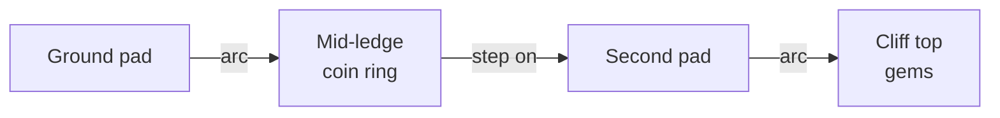
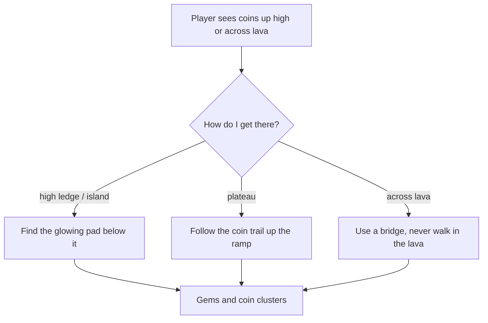

# Jump Pads and Navigation
Back to [[00 Coin Rush Design Index]] · `World/JumpPad.cs`, `PlayerController.LaunchTo`

## Aimed jump pads
A pad with a `landingTarget` computes a ballistic arc: apex = `max(start, landing) + arcHeight`, `vy = √(2·g·(apex − start))`, flight time = rise + fall, horizontal speed = distance ÷ flight time. The player always lands on the spot.

| World | Route |
|---|---|
| Meadow | 4 ground pads → 4 sky islands with gem rows |
| Desert | ground pad → ruin deck; temple stairs → tier-1 pad → tier-2 pad → top (chain bounce) |
| Frozen | ground pad → mid-ledge ring → pad → cliff top (both sides) |

## Ramps and bridges
Not everything needs a pad. The layouts also reward reading the level on foot:

| World | Walkable route | Reward |
|---|---|---|
| Meadow | two ramps up to the central plateau | coin trail up the ramp, ring of 10 coins on top |
| Desert | three bridges over each lava river | 3 coins on every bridge; the only safe way across |
| Desert | temple stairs | breadcrumb coins leading to the tier-1 pad |

