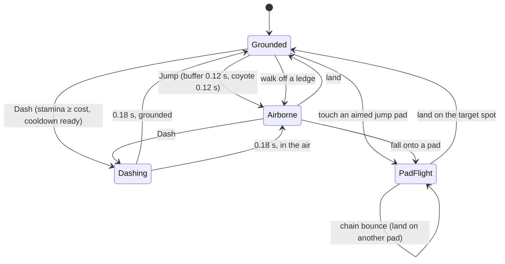

# Player Controller
Back to [[00 Coin Rush Design Index]] · Implemented in `Player/PlayerController.cs`, `PlayerHealth.cs`, `PlayerPowerUps.cs`

## Movement states

- **Sprint** drains stamina (30/s); stamina regenerates (20/s); running dry locks sprint until 25.
- **PadFlight** (`IsLaunched`): a ballistic arc computed from gravity so the hero lands exactly on the pad's `landingTarget`; steering and dashing are locked mid-arc. See [[Jump Pads and Navigation]].
- **Hero modifiers:** each hero's speed, jump and stamina ratings (1–5) scale the base stats by ±6% per point.
- **Damage:** invulnerability for 1.2 s after a hit, plus knockback. The shield blocks one hit.

Base values come from `PlayerStats.asset`, overridden by the `player` section of the JSON ([[Config and Save Data]]).
