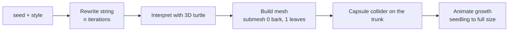

# Procedural Fractal Trees
Back to [[00 Coin Rush Design Index]] · `World/FractalTree.cs`, `World/FractalForest.cs`

Each world grows a small forest of **L-system trees at runtime**. Nothing is modelled by hand: the mesh (bark prisms and low-poly leaf clusters) is generated from a string grammar and a seed.

## Grammar (stochastic 3D L-system)
- **Axiom:** `FX` (a trunk segment and a bud)
- **Rules for the bud `X`** (chosen with seeded randomness):

| Rule | Probability | Shape |
|---|---|---|
| `X → F[&X]/[&X]/[&X]` | 0.45 | three-way split, spiralling |
| `X → F[+X][-X]/F[&X]L` | 0.30 | fork plus a leafy side shoot |
| `X → F/[&X]//[^X]FX` | 0.25 | long leader with alternating side branches |

After `iterations` rewrites, the remaining `X` become `L` (leaf clusters).

| Symbol | Turtle action |
|---|---|
| `F` | draw a tapered 6-sided branch segment, bend slightly upward |
| `+` `-` | tilt ± branchAngle (Z axis) |
| `&` `^` | pitch ± branchAngle (X axis) |
| `/` `\` | roll ± 137.5° (golden angle, spreads branches around) |
| `[` `]` | push / pop the turtle: branches get shorter (×lengthScale) and thinner (×0.62) |
| `L` | two random octahedra = one leaf blob |

## Styles per world
![[fractal_meadow.png]]
![[fractal_desert.png]]
![[fractal_frozen.png]]
*Rendered with `Coin Rush > Render Fractal Tree Previews` (three seeds per style).*

| World | Look | iterations | angle | lengthScale | leaves |
|---|---|---|---|---|---|
| Meadow | round oaks | 4 | 28° | 0.78 | green #4FB45A |
| Desert | wide acacias | 3 | 42° | 0.86 | olive #A5B84A |
| Frozen | slender frosted | 4 | 24° | 0.76 | frost #DDEFFF |

The builder chooses safe candidate spots (outer ring, away from pads, ramps, bridges, the start, the portal and colliders). `FractalForest` picks `treeCount` of them with a seeded shuffle. Everything can be re-tuned in the `forests` section of the JSON: see [[Config and Save Data]].
