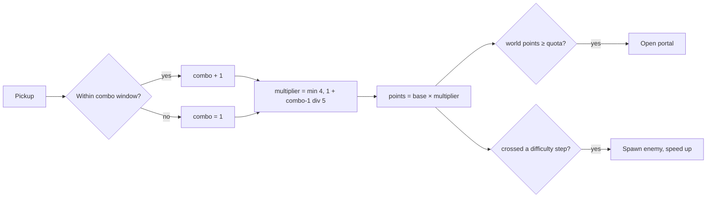

# Scoring and Combo
Back to [[00 Coin Rush Design Index]] · Implemented in `GameManager.CollectCoin`

## Rules
- Every pickup within `comboWindow` (2.2 s) of the previous one continues the **combo**.
- **Multiplier** = `min(maxMultiplier, 1 + (combo − 1) / pickupsPerMultiplierStep)`, so +1 every 5 pickups, up to ×4.
- **Points** = `baseValue × multiplier` (coin = 1, gem = 5).
- The **portal opens** when the world's points reach `coinQuota` (Meadow 30, Desert 45, Frozen 60).
- **Difficulty** rises by 1 every `scorePerNewEnemy` points, and each step spawns another enemy.
- **Time bonus** on entering the portal = `TimeRemaining × timeBonusPerSecond`.

All of these numbers can be tuned in `coinrush_config.json` (see [[Config and Save Data]]).
